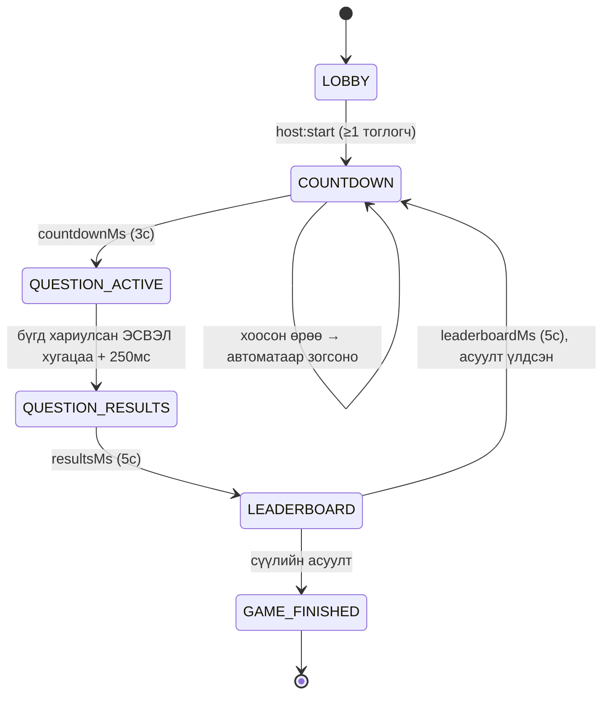
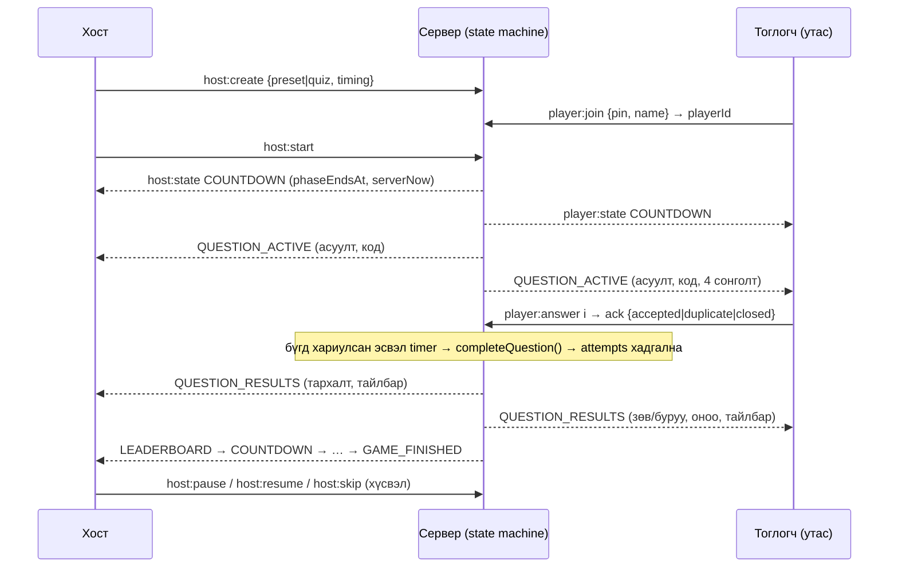

# QUIZ Platform V2: Тодорхойлолт (spec)

> PIAcademy-ийн курсын ажил · Автомат урсгалтай тоглоом, хөтөлбөрт суурилсан үнэлгээ, сургалтын аналитик
> Төлөв: **хэрэгжүүлсэн, тест хийсэн** (`npm test` 43/43). Энэ баримт кодтой нэг repo-д байгаа бөгөөд код өөрчлөгдөхөд хамт шинэчлэгдэнэ.

**Үндсэн зарчим:** сурахуйг хэмжигдэхүйц болгох, гэхдээ тоглоомыг хүндрүүлэхгүй.

---

## 1. Бүтээгдэхүүний шаардлага (шинэчилсэн)

| # | Шаардлага | Хэрэгжилт |
|---|---|---|
| R1 | Бүх тоглогч хариулмагц эсвэл хугацаа дуусмагц асуулт хаагдана | `Game.checkAllAnswered()` + timer, `completeQuestion()` нь зөвхөн нэг удаа ажиллана |
| R2 | Хөтлөгч товч дарахгүйгээр асуулт автоматаар ээлжилнэ | Серверийн state machine: RESULTS → LEADERBOARD → COUNTDOWN → дараагийн асуулт |
| R3 | 3-2-1 тоолол бүх төхөөрөмж дээр нэгэн зэрэг | Сервер `phaseEndsAt` + `serverNow` илгээнэ; клиент цагийн зөрүүг (`clockOffset`) засаж тоолно |
| R4 | Хугацааг тохируулах боломжтой | Анхдагч 5с / 5с / 3с (сервер). Quiz үүсгэх дэлгэц дээр 5–20с хооронд сонгоно (UI-ийн анхдагч тайлбар 8с) |
| R5 | Ярилцахын тулд түр зогсоох | ⏸ / ▶ / ⏭ товч. Идэвхтэй асуулт дунд зогсоохгүй (онооны хугацаа шударга байх үүднээс) |
| R6 | Асуулт бүрийн дараа тайлбар | Зөв хариулт, тайлбар, гол ойлголт, түгээмэл алдаа (хост + утас) |
| R7 | Хариулт бүрийг хадгална | `QuestionAttempt` (боломжит тоглогч × асуулт тутамд яг 1) → Firestore / JSON |
| R8 | Багшийн самбар нууц үгээр хамгаалагдсан | `/admin`, `ADMIN_PASSWORD`, HMAC token (12 цаг), 5 буруу оролдлого/мин хязгаар |
| R9 | Тоглоомын оноо ≠ сургалтын үнэлгээ | Оноо хурдыг шагнана; аналитик зөвхөн зөв эсэхэд тулгуурлана |
| R10 | Бүх текст монгол хэлээр | UI, асуулт, тайлбар, тайлан, зөвлөмж |

## 2. Хөтөлбөрийн сэдвийн бүртгэл (баталгаажуулалтын төлөвтэй)

**Course A · Програмчлалын үндэс** (`fullstack.mn/course/view.php?id=2`): курсын хуудаснаас **бүтэц** шалгасан (2026-11-21).
Видео хичээл 1–14: удиртгал, SPOJ, Dev C++, нөхцөл, кодын стандарт, ахисан нөхцөл, while/for, ахисан for, math.h, функц, 1D массив, 2D массив (онгоц буудах тоглоом), заагч ба тэмдэгт, толь бичиг, бүтэц/нэгдэл/тоочилт.
Лекц 1–8: оролт/гаралт · нөхцөлт оператор · давталт · функц · массив · мөр ба тэмдэгт · файл, бүтэц/нэгдэл/тоочилт · заагч.
⚠️ Лекцийн PDF-ийн **агуулгыг уншаагүй**. Асуултууд нь эдгээр сэдвийн стандарт C үйлдлийг шалгадаг бөгөөд бүх кодыг gcc 13 + clang дээр хөрвүүлж, гаралтыг нь шалгасан.

**Course B · Вэб хөгжүүлэлт** (`fullstack.mn/course/view.php?id=3`): **агуулга** нь `WebDev_LearnLand.html`-ээс (курсын PDF/PPT-ийн тэмдэглэл) баталгаажсан.
Хичээл 0 Вэбийн суурь (протокол, HTTP, DNS, хостинг, deployment) · 1 HTML үндэс · 2 зураг/хүснэгт/маягт/семантик · 3 CSS үндэс + Box model · 4 Flexbox/Grid/Responsive · 5 Bootstrap/Tailwind/v0 + JS эхлэл · 6 Instagram/Spotify дасгал.
⚠️ Сайтад шинээр нэмэгдсэн, гэхдээ **агуулгыг нь уншаагүй** материал: Git Lecture, JavaScript Lecture 1–2 (+ гэрийн даалгавар), CSS Framework: Tailwind Lecture (+ lab starter), HTML CSS Lecture/Quiz, CSS Lecture 3 example, Tic-Tac-Toe lab. Эдгээр PDF-ийг ирүүлбэл асуултыг шинэчилнэ.

Хамаарал (prerequisite): оролт/гаралт → нөхцөл → давталт → функц → массив → мөр → заагч/бүтэц; HTML бүтэц → маягт/семантик → CSS сонгогч → box model → layout → JS.

## 3–4. 20 асуулт ба зорилтын зураглал

Доорх хүснэгт `shared/curriculum.ts`-ээс автоматаар үүссэн. 50/50 хуваасан (C 10, Web 10): хоёр курс хоёулаа суурь бөгөөд 20 асуултаар аль нэгийг нь давамгайлуулах үндэслэл алга. Түвшин: суурь 5 · дунд 10 · ахисан 5.
Тоглоом бүр эхлэхэд хариултын байрлалыг санамсаргүй холино (`shuffleQuestion`). Ингэхдээ буруу ойлголтын мета өгөгдөл хамт шилжинэ.

**Баталгаажуулалт:** C 10 код → `gcc -std=c99 -Wall` ба `clang -std=c11` хоёулаа ижил гаралттай (Q06 нь зориуд `-Wparentheses` анхааруулга өгнө, алдаа биш). CSS 4 асуулт → Chrome-ийн `getComputedStyle`/`getBoundingClientRect` (Q09-ийн 350px-ийг `content-box`-оор тодорхой шалгасан). JS 2 асуулт → Node 22. Тодорхойгүй үйлдэл (undefined behavior) болон хөрвүүлэгчээс хамаарах үр дүн байхгүй.

| Курс | Сэдэв | Суралцахуйн зорилт | Түвшин | Асуулт |
|---|---|---|---|---|
| Вэб хөгжүүлэлт | Вэбийн суурь: HTTP, DNS, хүсэлтийн урсгал | HTTP статус кодын ангиллыг бодит нөхцөлд хэрэглэх | Суурь | Q01 |
| Програмчлалын үндэс | Оролт/гаралт, арифметик | Бүхэл тооны хуваах (/) ба үлдэгдэл (%) үйлдлийн үр дүнг урьдчилан хэлэх | Суурь | Q02 |
| Вэб хөгжүүлэлт | HTML бүтэц, файлын зам | Relative зам ашиглан өөр хавтас дахь файлыг зөв заах | Суурь | Q03 |
| Програмчлалын үндэс | Бүтэц, нэгдэл, тоочилт | Бүтцийн (struct) хувьсагчийн талбарт хандах | Суурь | Q04 |
| Вэб хөгжүүлэлт | Маягт, семантик HTML | radio input-ийн бүлэглэлтийг (name) ойлгох | Суурь | Q05 |
| Програмчлалын үндэс | Нөхцөл шалгах оператор | = (оноолт) ба == (харьцуулалт)-ын ялгааг нөхцөлд таних | Дунд | Q06 |
| Вэб хөгжүүлэлт | CSS сонгогч, specificity | Specificity тооцож аль дүрэм ялахыг тодорхойлох | Дунд | Q07 |
| Програмчлалын үндэс | Давталт (while, for) | for давталтын давталтын тоог алхам (step)-тай үед тооцох | Дунд | Q08 |
| Вэб хөгжүүлэлт | Box model | Box model-оор элементийн бодит өргөнийг тооцох | Дунд | Q09 |
| Програмчлалын үндэс | Функц | Утгаар дамжуулах (pass by value)-ын үр дагаврыг ойлгох | Дунд | Q10 |
| Вэб хөгжүүлэлт | Flexbox, Grid, Responsive | flex-direction өөрчлөгдөхөд үндсэн/хөндлөн тэнхлэг солигдохыг ойлгох | Дунд | Q11 |
| Програмчлалын үндэс | Массив (1 ба 2 хэмжээст) | Хэсэгчлэн утга оноосон массивын үлдсэн элементийн утгыг мэдэх | Дунд | Q12 |
| Вэб хөгжүүлэлт | Flexbox, Grid, Responsive | auto-fit + minmax-ийн багана тооцоог урьдчилан хэлэх (responsive grid) | Дунд | Q13 |
| Програмчлалын үндэс | Массив (1 ба 2 хэмжээст) | 2 хэмжээст массивын [мөр][багана] индексийг унших | Дунд | Q14 |
| Вэб хөгжүүлэлт | JavaScript: хувьсагч, массив, функц | const нь дахин оноолтыг хориглодог боловч массивын агуулгыг өөрчлөхийг хориглодоггүйг ойлгох | Дунд | Q15 |
| Програмчлалын үндэс | Давталт (while, for) | Дотоод давталтын эхлэл гадаад хувьсагчаас хамаарах үед нийт давталтыг тооцох | Ахисан | Q16 |
| Вэб хөгжүүлэлт | JavaScript: хувьсагч, массив, функц | filter ба map-ийг дараалуулан хэрэглэх үр дүнг урьдчилан хэлэх | Ахисан | Q17 |
| Програмчлалын үндэс | Тэмдэгт мөр, string.h | strlen ба sizeof-ийн ялгаа, мөрийн төгсгөлийн \0 тэмдэгтийг ойлгох | Ахисан | Q18 |
| Вэб хөгжүүлэлт | Вэбийн суурь: HTTP, DNS, хүсэлтийн урсгал | Хаяг бичээд Enter дарахаас хуудас харагдах хүртэлх алхмуудыг зөв дараалуулах | Ахисан | Q19 |
| Програмчлалын үндэс | Заагч | Заагчаар дамжуулан хувьсагчийн утгыг өөрчлөхийг ойлгох | Ахисан | Q20 |

**Шалгаагүй сэдвүүд:** Файлын боловсруулалт (Програмчлалын үндэс), math.h, сан (Програмчлалын үндэс), Git (Вэб хөгжүүлэлт), Tailwind CSS (Вэб хөгжүүлэлт), JavaScript DOM, event (Вэб хөгжүүлэлт)


## 5. Автомат тоглоомын state machine



**Боломжит (eligible) тоглогч:** асуулт **эхлэх агшинд** сессэд байгаа бөгөөд **холбогдсон** тоглогч. Асуулт эхэлсний дараа нэгдсэн эсвэл тэр үед салсан байсан тоглогч тухайн асуултад тооцогдохгүй ("оролцоогүй"). Харин дараагийн асуултаас боломжит болно. Боломжит тоглогч салаад буцаж ирээгүй бол "хариулаагүй" гэж бичигдэнэ.

| Онцгой тохиолдол | Шийдэл |
|---|---|
| Тоглогч асуулт дунд салах | Хүлээхгүй; хариулаагүй гэж бичигдэнэ; хугацаа дотор буцаж ирвэл хариулж болно |
| Дахин холбогдох | `sessionStorage` дахь `playerId`-аар ижил оролцогч болж буцна (оноо хадгалагдана) |
| Давхар хариулт | Эхнийх нь хүчинтэй, дараагийнх нь `duplicate` |
| Тоглоом эхэлсний дараа нэгдэх | Зөвшөөрнө, дараагийн асуултаас боломжит |
| Хариулаагүй, хугацаа дууссан | `status: unanswered, timedOut: true` |
| Хоосон өрөө | Асуулт эхлүүлэхгүй, автоматаар зогсоно; хэн нэгэн нэгдмэгц үргэлжилнэ |
| Хост салах | Асуулт дуусмагц автоматаар зогсоно; `hostKey`-ээр буцаж ирнэ; 10 мин ирэхгүй бол `abandoned` |
| Сүүлийн хариулт ба timer зэрэг | `completeQuestion()` эхэндээ `phase !== QUESTION_ACTIVE` бол буцна; phase-ийг синхроноор солино → яг 1 удаа |

## 6. Бодит цагийн event дараалал



## 7. Өгөгдлийн бүтэц (schema)

Одоогийн хэрэгжилт: `GameSessionRecord` нэг document (Firestore `sessions/{id}`, эсвэл `data/{id}.json`). Тайланг үргэлж түүхий `attempts`-аас дахин тооцно. PostgreSQL + Prisma руу шилжих бол доорх relational загварыг ашиглана.

```prisma
model Course            { id String @id; name String; url String; topics Topic[] }
model Topic             { id String @id; courseId String; name String; source String
                          course Course @relation(fields:[courseId], references:[id]); objectives LearningObjective[] }
model LearningObjective { id String @id; topicId String; text String; topic Topic @relation(fields:[topicId], references:[id]) }
model Quiz              { id String @id; title String; questions Question[] }
model Question          { id String @id; quizId String; topicId String?; objectiveId String?; order Int
                          difficulty String; text String; code String?; explanation String; keyConcept String?
                          timeLimitSec Int; source String?; options AnswerOption[]
                          @@index([quizId, order]) }
model AnswerOption      { id String @id; questionId String; idx Int; text String; isCorrect Boolean; misconception String?
                          @@unique([questionId, idx]) }
model GameSession       { id String @id @default(uuid()); quizId String; pin String; status String
                          startedAt DateTime?; finishedAt DateTime?; demo Boolean @default(false)
                          quizSnapshot Json   // холисон дараалал, асуулт засагдсан ч тайлан өөрчлөгдөхгүй
                          participants Participant[]; attempts QuestionAttempt[]; @@index([startedAt]) }
model Participant       { id String @id @default(uuid()); sessionId String; nickname String; joinedAt DateTime
                          joinedAtQuestion Int; finalScore Int; finalRank Int; @@index([sessionId]) }
model QuestionAttempt   { id String @id @default(uuid()); sessionId String; participantId String
                          questionId String; questionIndex Int; selectedOption Int?; status String // correct|incorrect|unanswered
                          isCorrect Boolean; responseTimeMs Int?; timeLimitMs Int; scoreAwarded Int
                          topicId String?; courseId String?; difficulty String?; submittedAt DateTime?; timedOut Boolean
                          @@unique([sessionId, participantId, questionIndex])   // нэг хүн нэг асуултад нэг л бичлэг
                          @@index([sessionId, questionIndex]) @@index([sessionId, topicId]) }
model GameResult        { sessionId String @id; reportJson Json; computedAt DateTime } // cache, түүхий өгөгдлөөс дахин тооцож болно
```

**Validation:** 4 сонголт, `correct` 0–3, хугацаа 5–120с, нэр ≤20 тэмдэгт ба давхардахгүй, хамгийн ихдээ 50 асуулт. **Хадгалах хугацаа:** `RETENTION_DAYS` (анхдагч 180 хоног), эхлэх үед хуучныг устгана. **Хувийн мэдээлэл:** зөвхөн тоглогчийн өөрөө бичсэн хоч. ID нь сесс доторх UUID.
**Хязгаар:** Firestore document 1MB → нэг сессэд ~100 тоглогч × 20 асуулт хүртэл.

## 8. Аналитикийн томъёо (хуваарийг тодорхой заасан)

E = боломжит (тоглогч × асуулт) хос. E бүрт яг нэг attempt байна: correct | incorrect | unanswered.

| Үзүүлэлт | Томъёо |
|---|---|
| Асуултын зөв % | correct_q / eligible_q × 100 (**хариулаагүйг хуваарьт оруулна**) |
| Сэдвийн зөв % | Σ correct (сэдэв) / Σ eligible attempts (сэдэв) × 100 + асуултын тоо, хариултын тоо |
| Курсийн зөв % | Σ correct (курс) / Σ eligible attempts (курс) × 100 |
| Сурагчийн зөв % | correct_s / тухайн сурагч боломжит байсан асуултын тоо × 100 |
| Оролцоо | (correct + incorrect) / eligible × 100 |
| Дуусгалт (completion) | Сүүлийн асуултад боломжит байсан оролцогч / нийт оролцогч × 100 |
| Дундаж хугацаа | mean(responseTimeMs), зөвхөн хариулсан бичлэгээр |
| Сонголтын тархалт | option_i / eligible_q; хариулаагүйг тусад нь |

**Шошго:** ≥80% → "Шалгасан асуултууд дээр сайн гүйцэтгэлтэй" · 50–79% → "Нэмэлт дасгал хэрэгтэй" · <50% → "Сэдвийг давтах шаардлагатай" · <2 асуулт → "Нотолгоо хангалтгүй". Ганц асуулттай сэдвийг тусад нь тэмдэглэнэ. Шалгаагүй сэдвийг хэзээ ч "эзэмшсэн" гэж тооцохгүй.
**Бүрэн бүтэн байдлын шалгалт:** attempts = Σ eligible, давхардал = 0 (тайлан бүрт тооцогдоно).

## 9–10. Багшийн самбар

`/admin` → нууц үг → сессийн жагсаалт → тайлан. Табууд:
- **Тойм:** KPI картууд (оролцогч, асуулт, илгээсэн хариулт, зөв %, хариулаагүй, дундаж хугацаа, дуусгалт, хамрагдсан сэдэв), хамгийн хүндрэлтэй/сайн сэдэв, эхний 5 зөвлөмж
- **Курс:** хоёр курсийн карт (зөв/буруу/хариулаагүй давхарласан bar), харьцуулсан bar
- **Сэдэв:** хэвтээ bar (өнгө: ногоон ≥80, шар 50–79, улаан <50) + шошго; дарахад буруу ойлголт, дасгал хэрэгтэй сурагчид; хамрах хүрээний хүснэгт
- **Асуулт:** 20 мөр (сэдэв, түвшин, зөв %, З/Б/Х, дундаж, хамгийн их сонгосон буруу хариулт + буруу ойлголт); дарахад сонголтын тархалт, код, тайлбар
- **Сурагч:** байр, оноо, З/Б/Х, зөв %, курсээр; дарахад сэдвээр болон хариултын түүх
- **Матриц:** сурагч × Q1–20 (✓ ✕ – ⬚), курс/сэдвээр шүүлт, нүд дээр дарахад асуулт, сонгосон хариулт, зөв хариулт, тайлбар
- **Тайлан:** 10 хэсэгтэй хэвлэх тайлан + CSV татах

Шилдэг практик: дүнг "сургалтын дохио" гэж нэрлэнэ, сурагчийг хэзээ ч "чадваргүй" гэж тодорхойлохгүй. ДЕМО өгөгдөл нь `demo: true` бөгөөд "ДЕМО" шошготой харагдана.

## 11. Гурван өдрийн төлөвлөгөө (ба одоогийн төлөв)

| Өдөр | Ажил | Төлөв |
|---|---|---|
| 1 | Хөтөлбөр шалгах, 20 асуулт, schema, session | ✅ (C лекцийн PDF агуулга, шинэ Web PDF-үүд үлдсэн) |
| 2 | State machine, эрт дуусгах, 3-2-1, хариулт бичих, edge case тест | ✅ |
| 3 | Хадгалалт, аналитик, самбар, бүтэн 20 асуултын туршилт, демо | ✅ хэрэгжсэн · ⏳ ангид бодит туршилт |

P0 ✅ · P1 ✅ · P2: CSV ✅, автомат зөвлөмж ✅, хэвлэх тайлан ✅, түүхэн чиг хандлага ❌ (сесс хоорондын харьцуулалт хийгдээгүй)

## 12. Тест ба хүлээн авах шалгалт

`npm test` → `tests/acceptance.mjs` (43 шалгалт). Бүгд хариулбал эрт дуусах · timeout · хариулаагүй · давхар/буруу хариулт · хаагдсаны дараах хариулт · салах/дахин холбогдох · хожуу нэгдэх · хилийн агшин (яг 1 бичлэг) · pause/resume/skip · хоосон өрөө · хост салах · state machine-ий дараалал · админ хамгаалалт · Σ асуулт = Σ курс = нийт · хариулаагүйг хуваарьт оруулах · хожуу нэгдсэн сурагчийн хуваарь · CSV мөр = attempts · тоглоом дууссаны дараа тайлан хадгалагдсан.
Гараар: 20 асуултыг 2+ утсаар бүтэн тоглох, тайлангийн тоог матрицтай тулгах, утсан дээрх код уншигдах эсэх.

## 13. Эрсдэл, хязгаарлалт, хялбаршуулалт

- **Хөтөлбөрийн бүрэн байдал:** C лекцийн PDF болон Web-ийн шинэ PDF-үүд (Git, JS 1–2, Tailwind) уншигдаагүй. Тиймээс асуултууд "хөтөлбөрийн бүрэн хамрах хүрээ" гэж мэдэгдэхгүй. 5 сэдэв шалгагдаагүй (дээрх жагсаалт).
- **Нэг instance:** тоглоомын төлөв санах ойд хадгалагддаг (`max-instances 1`). Сервер дахин асвал явагдаж буй тоглоом тасарна. Хадгалсан хариултууд Firestore-д үлдэнэ.
- **Нотолгоо хязгаарлагдмал:** 20 асуулт, ихэнх сэдэвт 1–2 асуулт → шошго болгоомжтой.
- **Хурд ба ойлголт:** тоглоомын оноо хурдыг шагнана; сургалтын үзүүлэлтэд хурд орохгүй.
- **Хялбаршуулалт:** нэг document-ийн хадгалалт (Prisma schema бэлэн); нэг нууц үгтэй админ (олон багшийн эрх биш); PDF/Excel экспорт хийгээгүй (CSV + хөтчөөр хэвлэх).
- **Cloud кредит:** demo URL нь DevFest-ийн $5 кредитээр ажиллаж байгаа, 2026-11-22 04:31-д дуусна. Байнга ажиллуулах бол Railway/Render + PostgreSQL руу шилжүүлнэ.

---

## Хавсралт: 20 асуулт, хариулт, буруу ойлголт, тайлбар

**Хуваарилалт:** C 10 · Web 10 · Суурь 5 · Дунд 10 · Ахисан 5

### 20 асуулт, хариулт, тайлбар

**Q01** · Вэб хөгжүүлэлт · Суурь · 20с — Хэрэглэгч сайтаас аль хэдийн устгагдсан хуудасны холбоосыг нээлээ. Сервер ямар статус код буцаах нь зөв бэ?

- ◻️ `200 OK` — _Хуудас нээгдсэн бол бүх зүйл OK гэж бодох_
- ✅ `404 Not Found`
- ◻️ `500 Internal Server Error` — _Бүх алдааг серверийн алдаа гэж ойлгох_
- ◻️ `301 Moved Permanently` — _Устгасан, зөөсөн хоёрыг ялгахгүй байх_

> Хүссэн хуудас серверт байхгүй тул 404 буцаана. 4xx нь клиентийн хүсэлттэй холбоотой алдаа, 5xx нь сервер өөрөө эвдэрсэн үед гарна.  
> 🔑 2xx амжилт · 3xx шилжүүлэлт · 4xx клиент · 5xx сервер · Эх сурвалж: Introduction to Web Design · 04 Протокол (статус код)

**Q02** · Програмчлалын үндэс · Суурь · 20с — Энэ програм юу хэвлэх вэ?

```c
int a = 7, b = 2;
printf("%d %d", a / b, a % b);
```

- ◻️ `3.5 1` — _Бүхэл тоон хуваалтыг бодит тоон хуваалт гэж бодох_
- ✅ `3 1`
- ◻️ `4 1` — _Бүхэл хуваалт тоймлодог (round) гэж бодох_
- ◻️ `3 0` — _% үйлдлийг буруу ойлгох_

> a, b хоёулаа int тул 7 / 2 нь бутархай хэсгээ хаяад 3 болно. 7 % 2 нь үлдэгдэл буюу 1.  
> 🔑 int / int = бүхэл хуваалт (бутархай хаягдана) · Эх сурвалж: Лекц 1 · Анхны програм, оролт гаралт

**Q03** · Вэб хөгжүүлэлт · Суурь · 20с — pages/about.html файл дотроос images/logo.png зургийг харуулах зөв src аль нь вэ?

```
site/
├── index.html
├── images/logo.png
└── pages/about.html
```

- ◻️ `images/logo.png` — _Relative замыг файлын байршлаас биш, төслийн үндсээс тоолох_
- ✅ `../images/logo.png`
- ◻️ `./pages/images/logo.png` — _Хавтасны бүтцийг буруу уншиж pages/ дотор хайх_
- ◻️ `C:\site\images\logo.png` — _Өөрийн компьютерийн absolute замыг вэбэд ашиглах_

> about.html нь pages/ хавтас дотор байгаа тул эхлээд ../ гэж нэг хавтас дээш гарч, дараа нь images/ руу орно.  
> 🔑 ../ = нэг хавтас дээш · Эх сурвалж: HTML Lecture 1 · Файлын зам

**Q04** · Програмчлалын үндэс · Суурь · 20с — s хувьсагчийн нас (age)-ыг хэвлэх зөв бичлэг аль нь вэ?

```c
struct Student { char name[20]; int age; };
struct Student s = {"Bat", 20};
```

- ◻️ `printf("%d", s->age);` — _Бүтцийн хувьсагч ба заагчийг ялгахгүй байх_
- ◻️ `printf("%d", Student.age);` — _Төрлийн нэрээр (Student) талбарт хандаж болно гэж бодох_
- ✅ `printf("%d", s.age);`
- ◻️ `printf("%d", s[age]);` — _Бүтцийг массив шиг индексээр уншина гэж бодох_

> s нь заагч биш, энгийн бүтцийн хувьсагч тул талбарт цэгээр (s.age) хандана. -> нь зөвхөн бүтцийн заагчид ашиглагдана.  
> 🔑 Хувьсагч → s.field · Заагч → p->field · Эх сурвалж: Лекц 7 · Бүтэц, нэгдэл, тоочилт

**Q05** · Вэб хөгжүүлэлт · Суурь · 20с — Хэрэглэгч "Анхан", "Дунд" хоёр сонголтыг ЗЭРЭГ сонгож чадаж байна. Шалтгаан нь юу вэ?

```html
<input type="radio" name="lvl1" value="new"> Анхан
<input type="radio" name="lvl2" value="mid"> Дунд
```

- ◻️ `radio үргэлж олон сонголт зөвшөөрдөг` — _radio, checkbox хоёрыг андуурах_
- ✅ `name ялгаатай тул 2 тусдаа бүлэг болсон`
- ◻️ `value ижил байх ёстой` — _value атрибут бүлэглэдэг гэж бодох_
- ◻️ `<fieldset> байхгүй` — _fieldset нь логик бүлэглэл хийдэг гэж бодох (зөвхөн харагдах бүлэг)_

> Ижил name-тэй radio-нууд нэг бүлэг болж, тэдгээрээс зөвхөн нэгийг сонгоно. Энд name өөр тул хоёр тусдаа бүлэг болжээ. Засвар: хоёуланд нь name="lvl" өгнө.  
> 🔑 Ижил name = нэг бүлэг radio · Эх сурвалж: HTML Lecture 2 · Маягт

**Q06** · Програмчлалын үндэс · Дунд · 30с — Энэ програм юу хэвлэх вэ?

```c
int x = 0;
if (x = 5)
    printf("A");
else
    printf("B");
```

- ✅ `A`
- ◻️ `B` — _= -г харьцуулалт гэж уншсан_
- ◻️ `Хөрвүүлэлтийн алдаа гарна` — _Нөхцөлд оноолт бичих нь синтаксын алдаа гэж бодох (зөвхөн анхааруулга өгдөг)_
- ◻️ `Юу ч хэвлэхгүй` — _Нөхцөл ажиллахгүй гэж бодох_

> x = 5 нь харьцуулалт биш, оноолт. Илэрхийллийн утга нь 5 буюу 0 биш тоо тул үнэн гэж тооцогдоно. Тиймээс "A" хэвлэгдэнэ. Харьцуулахдаа == бичнэ.  
> 🔑 = оноох, == харьцуулах; 0 биш утга = үнэн · Эх сурвалж: Лекц 2 · Нөхцөлт оператор

**Q07** · Вэб хөгжүүлэлт · Дунд · 30с — Догол мөр ямар өнгөтэй харагдах вэ?

```css
<p id="intro" class="lead note">Сайн уу</p>

#intro { color: red; }
body p.lead.note { color: blue; }
p { color: green; }
```

- ✅ `Улаан`
- ◻️ `Цэнхэр` — _Олон class/tag нийлбэл id-г давна гэж бодох_
- ◻️ `Ногоон` — _Сүүлд бичсэн дүрэм specificity-ээс үл хамааран ялна гэж бодох_
- ◻️ `Хар (анхдагч)` — _Зөрчилтэй дүрмүүд бие биеэ цуцална гэж бодох_

> #intro нь 1-0-0, body p.lead.note нь 0-2-2. Оноог зүүнээс нь харьцуулдаг тул нэг id хэдэн ч class-аас хүчтэй. Тиймээс улаан.  
> 🔑 Specificity: id (1-0-0) > class (0-1-0) > tag (0-0-1) · Эх сурвалж: CSS Lecture 1 · Cascade, specificity

**Q08** · Програмчлалын үндэс · Дунд · 30с — Давталт дууссаны дараа count хэд болох вэ?

```c
int i, count = 0;
for (i = 1; i <= 10; i += 3)
    count++;
```

- ◻️ `3` — _<= нөхцөлийн хилийн утгыг орхих (off-by-one)_
- ✅ `4`
- ◻️ `10` — _Алхам (+3)-ыг үл тоож 1-ээр нэмэгдэнэ гэж бодох_
- ◻️ `11` — _Эхлэл ба төгсгөлийг хоёуланг нь илүү тоолох_

> i нь 1, 4, 7, 10 гэсэн утга авна (10 <= 10 үнэн). Дараа нь 13 болоход нөхцөл худал болж зогсоно. Тиймээс 4 удаа давтагдана.  
> 🔑 Давталтын утгуудыг нэг нэгээр нь бичиж шалга · Эх сурвалж: Лекц 3 · Давталт оператор

**Q09** · Вэб хөгжүүлэлт · Дунд · 30с — box-sizing тохируулаагүй (анхдагч content-box) үед .card-ийн дэлгэц дээрх бодит өргөн хэд вэ?

```css
.card {
  width: 300px;
  padding: 20px;
  border: 5px solid black;
}
```

- ◻️ `300px` — _Анхдагч box-sizing-ийг border-box гэж бодох_
- ◻️ `325px` — _Padding, border-ийг зөвхөн нэг талд тооцох_
- ◻️ `340px` — _Border-ийг тооцоонд оруулахгүй байх_
- ✅ `350px`

> content-box үед width нь зөвхөн агуулгын өргөн. Бодит өргөн = 300 + 20×2 (padding) + 5×2 (border) = 350px. border-box үед 300px болно.  
> 🔑 content-box: width + padding×2 + border×2 · Эх сурвалж: CSS Lecture 1 · Box model

**Q10** · Програмчлалын үндэс · Дунд · 30с — Энэ програм юу хэвлэх вэ?

```c
void inc(int x) {
    x++;
}

int main(void) {
    int a = 5;
    inc(a);
    printf("%d", a);
    return 0;
}
```

- ◻️ `6` — _Аргумент лавлахаар (by reference) дамждаг гэж бодох_
- ✅ `5`
- ◻️ `Санамсаргүй тоо` — _Функц дуудсаны дараа хувьсагч эвдэрнэ гэж бодох_
- ◻️ `Хөрвүүлэлтийн алдаа` — _void функц утга өөрчилж болохгүй тул алдаа гэж бодох_

> C хэлэнд аргументыг утгаар нь дамжуулдаг. inc() нь a-гийн хуулбар x-ийг өөрчилнө, a өөрөө 5 хэвээр үлдэнэ. a-г өөрчлөхийг хүсвэл заагч (int *x) дамжуулна.  
> 🔑 Функц аргументын хуулбартай ажиллана · Эх сурвалж: Лекц 4 · Функц

**Q11** · Вэб хөгжүүлэлт · Дунд · 30с — span босоо тэнхлэгийн дагуу төвд байна, гэхдээ хэвтээ тэнхлэгт зүүн талд наалдсан байна. Хэвтээ тэнхлэгт төвлөрүүлэхийн тулд .box-д юу нэмэх вэ?

```css
.box {
  display: flex;
  flex-direction: column;
  justify-content: center;
  height: 200px;
}
```

- ◻️ `justify-content: center;` — _justify-content-ийг үргэлж хэвтээ гэж бодох_
- ✅ `align-items: center;`
- ◻️ `text-align: center;` — _text-align нь flex хүүхдийн байрлалыг өөрчилнө гэж бодох_
- ◻️ `flex-wrap: wrap;` — _Мөр шилжүүлэх нь төвлөрүүлэлттэй холбоотой гэж бодох_

> flex-direction: column үед үндсэн тэнхлэг босоо болно. justify-content нь үндсэн (босоо) тэнхлэгийг, align-items нь хөндлөн (хэвтээ) тэнхлэгийг удирдана.  
> 🔑 justify-content → үндсэн тэнхлэг, align-items → хөндлөн тэнхлэг · Эх сурвалж: CSS Lecture 2 · Flexbox

**Q12** · Програмчлалын үндэс · Дунд · 30с — Энэ програм юу хэвлэх вэ?

```c
int a[5] = {1, 2, 3};
printf("%d", a[3] + a[4]);
```

- ◻️ `Санамсаргүй тоо` — _Хэсэгчилсэн initializer-ийн үлдэгдлийг тодорхойгүй гэж бодох_
- ✅ `0`
- ◻️ `3` — _Сүүлийн өгсөн утга давтагдана гэж бодох_
- ◻️ `Хөрвүүлэлтийн алдаа` — _Массивын хэмжээ ба утгын тоо таарах ёстой гэж бодох_

> Массивт хэсэгчлэн анхны утга өгөхөд үлдсэн элементүүд автоматаар 0 болдог. a[3] = 0, a[4] = 0 тул нийлбэр 0.  
> 🔑 Хэсэгчилсэн initializer → үлдсэн нь 0 · Эх сурвалж: Лекц 5 · Массив

**Q13** · Вэб хөгжүүлэлт · Дунд · 30с — .gallery-ийн өргөн 700px, gap 0 байна. Хэдэн багана үүсэх вэ?

```css
.gallery {
  display: grid;
  grid-template-columns:
    repeat(auto-fit, minmax(200px, 1fr));
}
```

- ◻️ `1` — _minmax-ийн 1fr-ийг "нэг л багана" гэж бодох_
- ◻️ `2` — _Хоёр баганаас илүү багтахгүй гэж бодох_
- ✅ `3`
- ◻️ `4` — _Баганын тоог дээш тоймлох_

> 200px-ээс багагүй хэдэн багана багтахыг тооцно: 700 / 200 = 3.5 → 3 багана. Дараа нь 1fr нь үлдсэн зайг хуваагаад багана бүр ≈233px болно.  
> 🔑 auto-fit + minmax = media query-гүй уян сүлжээ · Эх сурвалж: CSS Lecture 2 · Grid, Responsive

**Q14** · Програмчлалын үндэс · Дунд · 30с — Энэ програм юу хэвлэх вэ?

```c
int m[2][3] = {
    {1, 2, 3},
    {4, 5, 6}
};
printf("%d", m[1][0]);
```

- ◻️ `2` — _Мөр ба баганын индексийг сольж унших_
- ◻️ `1` — _Индексийг 1-ээс эхэлдэг гэж бодох_
- ✅ `4`
- ◻️ `5` — _Хоёр индексийг хоёуланг нь 1-ээр шилжүүлэх_

> Эхний индекс мөр, хоёр дахь нь багана. Индекс 0-ээс эхэлдэг тул m[1][0] нь 2 дахь мөрийн 1 дэх элемент буюу 4.  
> 🔑 m[мөр][багана], индекс 0-ээс · Эх сурвалж: Лекц 5 · Массив 2 хэмжээс

**Q15** · Вэб хөгжүүлэлт · Дунд · 30с — Энэ код юу хэвлэх вэ?

```js
const skills = ["HTML", "CSS"];
skills.push("JS");
console.log(skills.length);
```

- ◻️ `2` — _push нь массивыг өөрчлөхгүй гэж бодох_
- ✅ `3`
- ◻️ `TypeError: const өөрчлөх боломжгүй` — _const-ыг бүрэн өөрчлөгдөшгүй (immutable) гэж бодох_
- ◻️ `undefined` — _push нь буцаах утгагүй тул length тодорхойгүй гэж бодох_

> const нь skills хувьсагчид өөр утга онооход (skills = [...]) саад болно. Харин массивын агуулгыг push-оор өөрчлөх боломжтой. Урт нь 3 болно.  
> 🔑 const = дахин оноохгүй ≠ өөрчлөгдөшгүй · Эх сурвалж: Видео 12–13 · JavaScript хувьсагч, өгөгдлийн төрөл

**Q16** · Програмчлалын үндэс · Ахисан · 40с — Давталт дууссаны дараа cnt хэд болох вэ?

```c
int i, j, cnt = 0;
for (i = 0; i < 3; i++)
    for (j = i; j < 3; j++)
        cnt++;
```

- ◻️ `9` — _Дотоод давталтын эхлэл (j = i)-ийг үл тоох_
- ✅ `6`
- ◻️ `3` — _Зөвхөн гадаад давталтыг тоолох_
- ◻️ `5` — _Нэг давталтыг дутуу тоолох (off-by-one)_

> j нь i-ээс эхэлдэг. i=0 үед j=0,1,2 (3 удаа), i=1 үед j=1,2 (2 удаа), i=2 үед j=2 (1 удаа). Нийт 3 + 2 + 1 = 6.  
> 🔑 Давхар давталтын алхмыг i-ийн утга бүрээр хүснэгтэлж тоол · Эх сурвалж: Хичээл 7 · Advanced For Loop

**Q17** · Вэб хөгжүүлэлт · Ахисан · 40с — Энэ код юу хэвлэх вэ?

```js
const prices = [12000, 8000, 25000];
const result = prices
  .filter(p => p < 20000)
  .map(p => p * 0.5);
console.log(result);
```

- ◻️ `[6000, 4000, 12500]` — _filter-ийн нөхцөлийг үл тоох_
- ◻️ `[12000, 8000]` — _map-ийн үр дүнг орхих_
- ✅ `[6000, 4000]`
- ◻️ `[4000]` — _Нөхцөлийг урвуугаар хэрэглэх_

> filter эхлээд 20000-аас бага үнийг үлдээнэ: [12000, 8000]. Дараа нь map тус бүрийг 0.5-аар үржүүлнэ: [6000, 4000]. Анхны массив өөрчлөгдөхгүй.  
> 🔑 filter → сонгоно, map → хувиргана; шинэ массив буцаана · Эх сурвалж: Видео 13 · array, arrow function

**Q18** · Програмчлалын үндэс · Ахисан · 40с — Энэ програм юу хэвлэх вэ?

```c
#include <string.h>

char s[] = "Ursa";
printf("%d %d", (int)strlen(s), (int)sizeof(s));
```

- ◻️ `4 4` — _\0 тэмдэгтийг мартах_
- ✅ `4 5`
- ◻️ `5 5` — _strlen нь \0-г тоолдог гэж бодох_
- ◻️ `5 4` — _strlen, sizeof-ийн үүргийг сольж ойлгох_

> strlen нь \0 хүртэлх тэмдэгтийг тоолно: 4. sizeof нь массивын санах ойн хэмжээ бөгөөд төгсгөлийн \0-г оруулаад 5 байт.  
> 🔑 Мөр \0-ээр төгсдөг; sizeof үүнийг тоолно, strlen тоолохгүй · Эх сурвалж: Лекц 6 · Мөр ба тэмдэгт, string.h

**Q19** · Вэб хөгжүүлэлт · Ахисан · 40с — https://coffee.mn гэж бичээд Enter дарахад болох алхмуудын ЗӨВ дараалал аль нь вэ?

- ◻️ `GET хүсэлт → DNS → TCP → render` — _IP-гүйгээр хүсэлт илгээнэ гэж бодох_
- ✅ `DNS → TCP холболт → TLS → GET → render`
- ◻️ `TCP → DNS → GET → TLS → render` — _Холбогдох хаягаа мэдэхээс өмнө TCP тогтооно гэж бодох_
- ◻️ `DNS → GET → TCP → TLS → render` — _HTTP хүсэлт TCP холболтоос өмнө явна гэж бодох_

> Эхлээд DNS-ээс IP хаяг асууна. Дараа нь тэр IP-ийн 443 порттой TCP холболт тогтоож, TLS-ээр шифрлэнэ. Үүний дараа GET хүсэлт илгээж, ирсэн HTML-ийг render хийнэ.  
> 🔑 Хаяг → IP (DNS) → холболт (TCP) → шифр (TLS) → хүсэлт (HTTP) → дүрслэл · Эх сурвалж: Introduction to Web Design · 08 Нэгтгэл

**Q20** · Програмчлалын үндэс · Ахисан · 40с — Энэ програм юу хэвлэх вэ?

```c
int a = 10;
int *p = &a;
*p = *p + 5;
printf("%d", a);
```

- ◻️ `10` — _*p нь a-гийн хуулбар гэж бодох_
- ✅ `15`
- ◻️ `a-гийн санах ойн хаяг` — _* ба & үйлдлийг андуурах_
- ◻️ `5` — _Зөвхөн нэмсэн утгыг хадгална гэж бодох_

> p нь a-гийн хаягийг хадгална. *p гэдэг нь "p заасан газрын утга" буюу a өөрөө. Тиймээс *p = *p + 5 нь a = a + 5 болж, 15 хэвлэгдэнэ.  
> 🔑 &a = хаяг, *p = тэр хаяг дээрх утга · Эх сурвалж: Лекц 8 · Заагч


